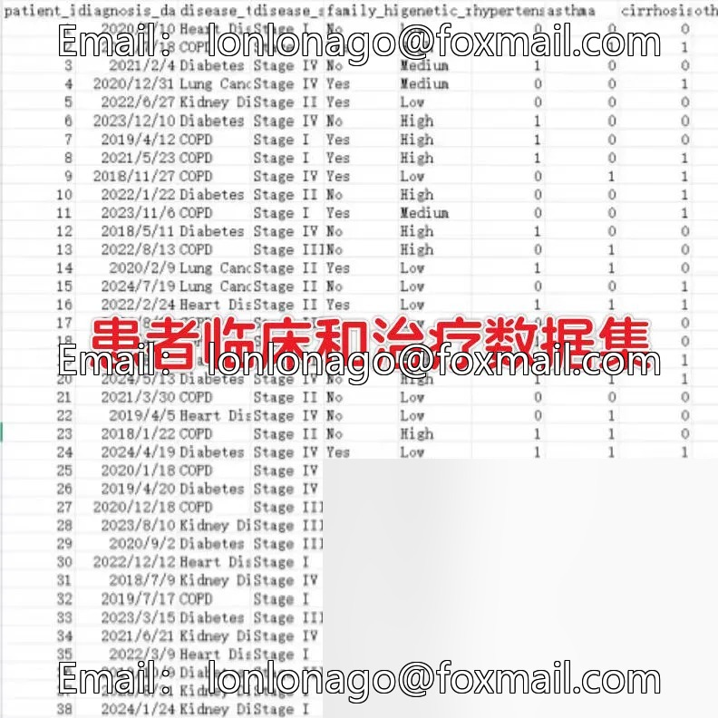
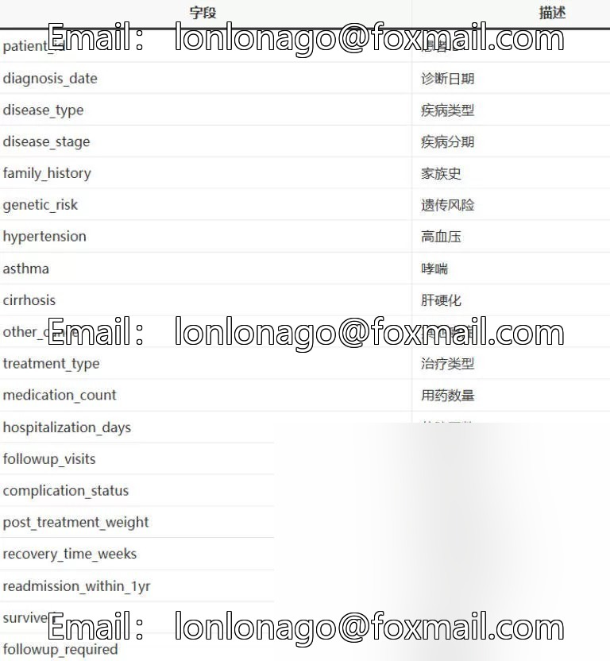
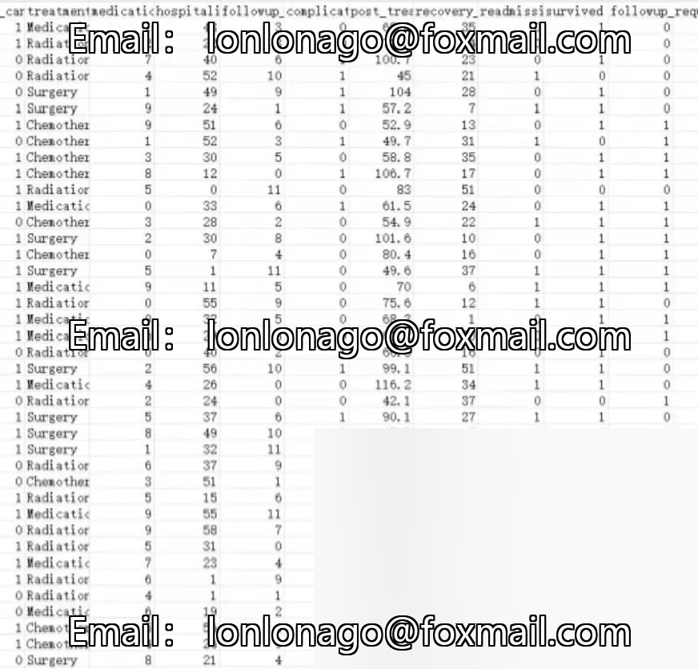

# Patient clinical and treatment dataset of 11,500 entries

## Body

Patient clinical and treatment dataset 11,500 entries

The dataset contains clinical and treatment records from 11,500 patients from multiple American hospitals.
These data come from electronic health records (EHR) to assist medical research, survival analysis, and predictive medical care modeling.

This dataset covers disease diagnosis, genetic risks, treatment types, hospitalization details, and post-treatment results.

Research application scope:
1. Prediction models for survival or re-admission
2. Survival analysis for chronic diseases and critical/severe diseases
3. Hospital resource planning and patient risk stratification
4. Research on the impact of treatment types on outcomes

Dataset characteristics
Rows: 11,500
Columns: 20
Data type: Mixed (numerical + classification + date)
Source: Aggregated anonymous EHR data from multiple US hospitals

web-based shipment, can be directly photographed and shipped.

The dataset contains clinical and treatment records for 11,500 patients from multiple US hospitals, covering diagnoses, genetic risk, treatment types, hospitalization details and post-treatment results, sourced from EHR electronic health records.

<!-- AI_ENRICHED -->

## Images

## Payment

Here is a pay link on Stripe ( https://buy.stripe.com/3cs8yP7sY87d0vu9AB ). Please contact me lonlonago@foxmail.com after funding $89, and I will send you a complete data files , thank you!

